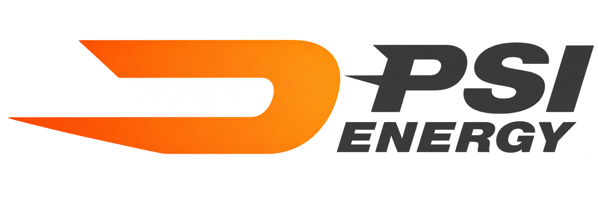

  
    
  
  **Tecnologia, Infraestrutura e Inovação em Energia**

  
  

---

### ⚡ Sobre a PSI Energy
Bem-vindo ao perfil oficial de Tecnologia da Informação e Desenvolvimento da **PSI Energy**. Este espaço centraliza nossos projetos internos, ferramentas de automação, portais corporativos e soluções voltadas à eficiência operacional.

---

### 🛠️ O que desenvolvemos e gerenciamos

* **🌐 Aplicações & Portais Web:** Desenvolvimento e deploy de sistemas internos, plataformas institucionais e portais de segurança (como o portal da **CIPA**).
* **🛡️ Segurança da Informação:** Gestão de perímetro de rede, monitoramento, políticas de proteção de e-mails e campanhas internas de conscientização contra ameaças digitais.
* **🖧 Infraestrutura & Redes:** Arquitetura de conectividade corporativa, alta disponibilidade, redundância de links e documentação de topologia de rede.
* **⚙️ Automação & Scripts:** Integrações via API e ferramentas internas para otimização de rotinas operacionais.

---

### 💻 Stack & Ferramentas Principais

  
  
  
  
  
  

---

  © 2026 PSI Energy • Departamento de Tecnologia da Informação

